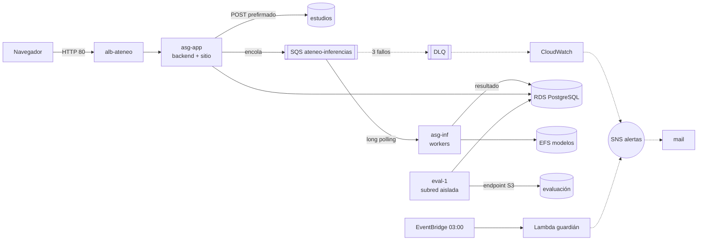

# Ateneo como código: Terraform + SQS + SNS + Lambda

Toda la arquitectura de la guía «Ateneo paso a paso» (secciones 02 a 10 y 14) declarada en
Terraform, más tres piezas nuevas que la hacen más robusta:

| Pieza nueva | Para qué | Archivo |
|-------------|----------|---------|
| **SQS** `ateneo-inferencias` + DLQ | La cola interna de inferencias. Reemplaza a la tabla-cola con `SKIP LOCKED`, al despachador y al barrido de huérfanos | `cola.tf` |
| **SNS** `ateneo-alertas` + alarmas de CloudWatch | Avisar por mail cuando un trabajo agota sus 3 intentos (DLQ), cuando la cola no avanza o cuando el backend se queda sin instancias sanas | `notificaciones.tf` |
| **Lambda** `ateneo-guardian` + EventBridge | Red de seguridad del presupuesto: todas las noches apaga lo que haya quedado prendido y avisa por SNS | `guardian.tf`, `lambda/guardian.py` |

Y lo que antes era a mano pasa a ser declarativo:

| Antes (guía) | Ahora |
|--------------|-------|
| Clics en la consola, §02 a §10 | `terraform apply` |
| `infra/entorno.sh` con cinco nombres elegidos a mano | Los genera Terraform (`ateneo-<rol>-<sufijo>`); `scripts/entorno-desde-terraform.sh` escribe `entorno.sh` para que `desplegar.sh` siga igual |
| `infra/generar-env.sh` (tipear la contraseña) | Terraform crea la contraseña, arma los tres `.env` y los sube a `config/` |
| `infra/userdata.sh` (rellenar huecos) | `templatefile()` con los valores reales, en `plantillas/` |
| Imagen dorada a mano (§8.2) | `imagen.tf` la construye sola la primera vez |
| `apagar.sh` / `prender.sh` | `terraform apply -var encendido=false` / `terraform apply` |
| `eval-1` con `run-instances` | `aws_instance.eval`; se relanza con `-replace` |

Lo que **no** cambia: `infra/desplegar.sh` (subir zips y el build) e `infra/refrescar.sh`
(reemplazar instancias, porque el lab deniega el instance refresh). La infraestructura sigue
sin saber qué hay adentro del zip.

## Arquitectura



En **modo `http`** (el de la guía) el tramo `APP → SQS → INF` es `APP → alb-ateneo-int → INF`.
El modo se elige con una variable, y el mismo código sirve para los dos:

| | `modo_inferencia = "http"` | `modo_inferencia = "sqs"` (por defecto) |
|-|-------------------------------------------|---------------------------|
| Cómo llega un trabajo al worker | Despachador del backend → ALB interno | El backend encola; los workers consumen |
| Reintentos | Columna `intentos` | `maxReceiveCount = 3` y DLQ |
| Un worker que muere a mitad | Barrido de huérfanos cada minuto | El mensaje vuelve solo al vencer la visibilidad (90 s) |
| Escalado de `asg-inf` | CPU 70 % | CPU 70 % **y** mensajes en cola por instancia |
| Quién escribe el resultado | El backend | El worker (sg-data ya acepta 5432 desde sg-worker) |
| Costo fijo que agrega | ALB interno ≈ USD 0,55/día | Endpoint de SQS en 2 zonas ≈ USD 0,48/día |

SQS se crea en los dos modos (vacío no cuesta nada), así que se puede pasar de uno a otro sin
recrear nada más que el ALB interno y el endpoint.

### Por qué así, y por qué no lo demás

- **SQS para la cola interna.** La tabla con `SKIP LOCKED` funciona, pero obliga a resolver a
  mano lo que SQS ya trae: reintentos con techo, huérfanos y aislamiento de los que fallan
  siempre. Y desacopla de verdad: si todos los workers están caídos, el backend sigue
  aceptando trabajos y se procesan cuando vuelven. La tabla `trabajo` sigue siendo la fuente
  de verdad de lo que ve la pantalla.
- **Sin ALB interno en modo sqs.** Con consumidores que tiran de la cola no hay nada que
  balancear. El endpoint de interfaz de SQS cuesta lo mismo y deja a la subred de inferencia
  sin internet, como estaba.
- **El evaluador sigue leyendo la tabla `modelo`.** Son pocas evaluaciones por semana, y una
  cola obligaría a darle a la subred aislada un camino a un endpoint de SQS, que es justo lo
  que la NACL impide (movimiento lateral, §9.4).
- **SNS para avisos, no para el flujo.** No hace falta fan-out entre servicios; lo que faltaba
  era enterarse de las fallas sin entrar a la consola.
- **Lambda para el presupuesto.** El mayor riesgo del lab no es técnico: es olvidarse algo
  prendido y quemar los USD 100. El guardián corre sin VPC (no necesita ver nada adentro),
  con `LabRole`, y lo dispara una regla de EventBridge con permiso basado en recurso, sin rol
  propio.
- **Docker queda para desarrollo local.** `docker-compose.yml` ya reproduce la topología. En
  AWS la imagen dorada + zip cumple el mismo papel (dependencias fijas, código descartable), y
  pasar a ECS cambiaría el modelo de despliegue entero sin sumar robustez a esta entrega.

## Restricciones del Learner Lab que este código respeta

- **No crea roles ni usuarios de IAM.** Las instancias usan `LabInstanceProfile`, la Lambda
  usa `LabRole` (los dos se leen con `data`).
- **Sin `instance_refresh`** en los grupos (lo bloquea la SCP): se sigue usando `refrescar.sh`.
- **Sin CloudFront ni EC2 Instance Connect Endpoint** (no concedidos).
- **Credenciales de sesión:** se corre desde CloudShell, donde ya están puestas. No hay ninguna
  clave en el código ni en las variables.
- **El giga de CloudShell:** el proveedor de AWS ocupa unos 850 MB; `scripts/tf.sh` lo deja en
  `/tmp` y solo el binario de Terraform (90 MB) queda en `$HOME`.
- **`us-east-1`** y tipos de instancia variables (`tipo_worker = "m5.large"` si `c5.large` no
  está permitido).

## Primer despliegue (cuenta limpia)

Si ya tenés la arquitectura armada a mano, primero bajala (o usá otra cuenta): este código crea
todo desde cero con los mismos nombres (`asg-app`, `ateneo-db`, `alb-ateneo`…) y chocaría.

Todo en CloudShell, parado en el clon:

```bash
cd ~/ateneo && git pull
bash terraform/scripts/bootstrap-estado.sh            # una sola vez: bucket del estado + backend.hcl
cp terraform/terraform.tfvars.example terraform/terraform.tfvars
nano terraform/terraform.tfvars                       # tu mail para las alertas; lo demás puede quedar

# 1. Primero solo los buckets, para poder subir el código antes de que nazcan las instancias
bash terraform/scripts/tf.sh apply -target='aws_s3_bucket.b'
bash terraform/scripts/entorno-desde-terraform.sh     # escribe infra/entorno.sh
bash infra/desplegar.sh todo                          # backend, worker y frontend a S3

# 2. Todo lo demás (la base tarda 5-10 min; la imagen dorada, otros 5-10)
bash terraform/scripts/tf.sh apply
bash terraform/scripts/tf.sh output url
```

Después, igual que la guía §15: aplicar `migraciones/001_inicial.sql` desde una instancia app
por Session Manager, subir el modelo y el conjunto reservado, y apretar «Publicar». Si pusiste
un mail, AWS te manda una confirmación de SNS que hay que aceptar.

## Un equipo de varias personas

Los nombres de bucket son únicos en todo AWS, pero nadie los elige a mano: Terraform les pone
un sufijo al azar (`ateneo-modelos-k3x9qz`) la primera vez y lo guarda en el estado. Cada
Learner Lab es una cuenta de AWS distinta, así que:

- **Cada integrante puede levantar su propio entorno** en su lab con los mismos comandos. El
  bucket del estado lleva el número de cuenta (`ateneo-tfstate-<cuenta>`) y los cinco de la
  aplicación su sufijo: no chocan nunca. Los demás nombres (`asg-app`, `ateneo-db`…) son por
  cuenta, como en la guía.
- **Lo que se comparte es el repositorio**, no la infraestructura. `terraform.tfvars`,
  `backend.hcl` e `infra/entorno.sh` son de cada uno y no se commitean (`.gitignore`).
- **El entorno de la demo vive en un solo lab.** El de otra persona no se puede administrar
  desde tu cuenta: para trabajar sobre el mismo entorno, lo opera quien es dueño de ese lab.
- Si querés nombres reconocibles, cada uno pone su propio `sufijo` en `terraform.tfvars`
  (por ejemplo `sufijo = "iker"`). Tiene que ser distinto entre personas.

## El día a día

| Qué | Comando |
|-----|---------|
| Antes de End Lab | `bash terraform/scripts/tf.sh apply -var encendido=false` |
| Al volver | `bash terraform/scripts/tf.sh apply` |
| Cambió el backend o el frontend | `bash infra/desplegar.sh backend` (o `frontend`) · `bash infra/refrescar.sh asg-app` |
| Cambió el worker o `ateneo_ml` | `bash infra/desplegar.sh worker` · `bash infra/refrescar.sh asg-inf` · `bash terraform/scripts/tf.sh apply -replace='aws_instance.eval[0]'` |
| Ver qué cambiaría | `bash terraform/scripts/tf.sh plan` |
| Fin del curso | `permitir_borrar_buckets = true` en tfvars · `apply` · `destroy` |

`encendido = false` borra el NAT y los dos balanceadores, pone los grupos en 0, termina
`eval-1` y detiene la base. Al prender, los balanceadores nacen con otro DNS: Terraform vuelve
a escribir los `.env` y el CORS de los buckets con el nuevo. **Cada `apply` sin
`-var encendido=false` prende todo**, así que el comando de apagar es el único que lleva la
variable.

Si te olvidás, el guardián hace lo mismo a las 03:00 (hora argentina) y te manda un mail con lo
que apagó. AWS vuelve a prender la base sola a los 7 días; el guardián la detiene esa noche.

## Pruebas sin cuenta

```bash
cd terraform
terraform init -backend=false
terraform validate
terraform test          # 4 planes contra un AWS simulado: modo http, modo sqs, apagado, imagen
```

## Cómo funciona el modo sqs en el código

Se elige con `MODO_INFERENCIA` en los `.env` (Terraform los escribe). Sin esa variable todo
anda como antes, así que el `docker-compose.yml` local sigue en modo http sin tocarlo.

**Backend**
- `EncolarInferencia` guarda el trabajo `pendiente` y lo manda a la cola con
  `ColaInferenciasSqs` (`backend/app/infraestructura/sqs/`). El cuerpo es el mismo JSON que
  recibe `POST /inferir` (`PeticionInferencia.como_mensaje()`). Si SQS no contesta, el usuario
  no ve un error: el trabajo queda `pendiente`.
- El despachador se reemplaza por el `Reenviador` (`aplicacion/reenviador.py`): cada minuto
  vuelve a encolar los `pendiente` de más de `REENVIO_MINUTOS` (5) y pasa a `error` los
  `en_curso` sin noticias hace `VENCIMIENTO_EN_CURSO_MINUTOS` (10), que son los que terminaron
  en la DLQ porque el worker murió en el último intento.

**Worker** (`worker/consumidor.py`)
- Un hilo hace long polling a la cola (de a un mensaje), mientras `/health` sigue contestando.
- Por cada mensaje: toma el trabajo en la base (`en_curso`, `intentos + 1`), infiere, guarda
  el resultado y **recién entonces** borra el mensaje. Si el trabajo ya estaba terminado (SQS
  entrega *al menos* una vez), lo descarta sin inferir.
- Error definitivo (imagen ilegible, modelo incompatible, objeto inexistente): `error` y se
  borra. Error transitorio: vuelve a `pendiente` y el mensaje reaparece a los 10 s. En la
  tercera recepción se marca `error` y el mensaje se deja: SQS lo pasa a la DLQ y la alarma
  avisa por mail.
- Escribe en la base con una conexión propia de `psycopg` (ya está en la imagen dorada).

**Pruebas:** `backend/tests/test_sqs.py` y `tests/test_consumidor.py`, con fakes y con el
`Stubber` de botocore. La suite completa da 65 tests en verde.
